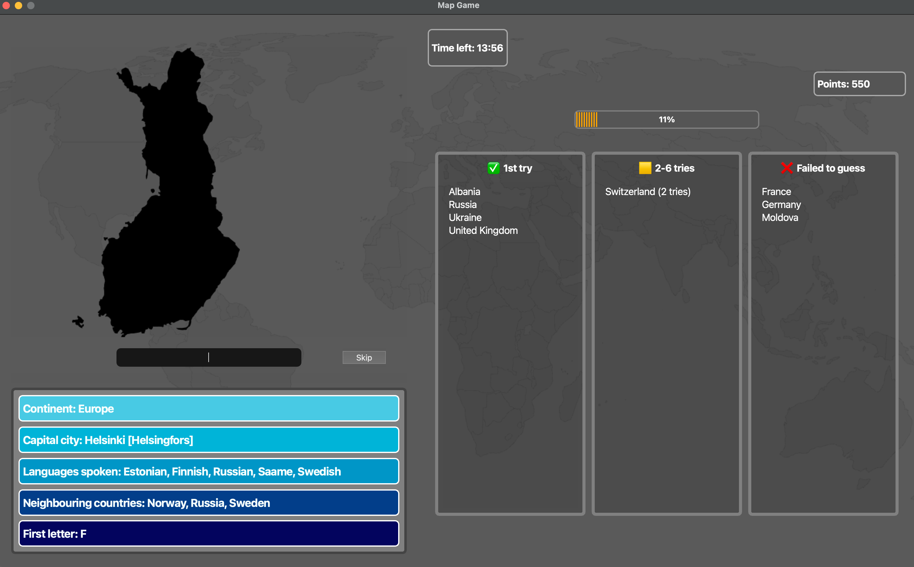

# World Map Guessing Game (Kartta-arvauspeli)

An interactive geography game built with Python and PyQt6. Guess countries from map outlines or flags, get hints after wrong answers, read country facts and race against a timer.



## Quick start

```bash
git clone https://github.com/danletech/Y2_2026_karttapeli.git
cd Y2_2026_karttapeli
python3 -m venv .venv
source .venv/bin/activate   # Windows: .venv\Scripts\activate
pip install -r requirements.txt
python main.py
```

## How to play

- Choose a continent, play with map images or flags, and pick a difficulty level (it changes the timer length).
- Guess the country shown. Points per attempt: 120 / 100 / 80 / 60 / 40 / 20. No points if you fail to guess it.
- Skipping a country costs 10 points.
- The game ends when the time runs out or when all countries are guessed.

## Technical overview

- **Object-oriented design:** country data is read from several JSON files by a parser (`maiden_tiedot_parser.py`) and turned into `Maa` (country) objects with attributes such as capital, languages and neighbours.
- **Game logic** (`peli.py`) is separated from the **PyQt6 GUI** (`gui_aloitusikkuna.py`, `gui.py`, `gui_vasen_puoli.py`, `gui_oikea_puoli.py`).
- Extras: timer with colour changes, hint box, skip button, typo detection for non-existent countries, progress bar, score box and lists of guessed countries.
- Unit tests for the parser, country and game classes are in `testit/`.

## Known limitations

- The game window has a fixed size, so it may look different on different monitors.
- Marshall Islands, Micronesia and Tuvalu are excluded because they had no map image.
- Country facts are shown after a guess; clicking countries on the map is not supported.

*Author: Dan Le. Suomenkielinen kuvaus alla / Finnish description below.*

# Kartta-arvauspeli (2026)
* Kartta-arvauspeli on interaktiivinen peli, jossa pelaaja arvaa maita, saa vinkkejä väärien vastausten jälkeen, saa lukea maan perustiedot, ansaita pisteitä ja haastaa itseään aikaa vastaan. 

## Tekijä
* Dan Le
* dan.le@aalto.fi


## Pelin ominaisuudet
Olen rakentanut Olio-ohjelmoinnilla Interaktiivisen karttapelin. Pelissä
* Luetaan ja yhdistetään maailman maiden tiedot eri JSON-tiedostosta parserin avulla (maiden_tiedot_parser). 
* Luodaan näistä tiedoista Maa-olioita, joilla on omat attribuutit (esim. pääkaupunki, kielet, naapurit).
* Peli-luokkassa metodit mm. arpoo pelin maat, tarkistaa arvaukset ja päivittää yhden arvauksen tietoja. 
* Käyttöliittymän puolella aloitusikkuna antaa pelaajan valita mitä pelimoodeja pelaaja haluaa pelata.
* Gui-luokka on vastuussa pelin visuaalisesta puolesta eli se näyttää ja päivittää peli-ikkunan.
* Lopetusikkuna ilmoittaa pelin loputtua, kuinka paljon pisteitä pelaaja keräsi ja kuinka monta maata hän arvasi
* Yksityiskohtaisempia asioita: ajastin ja sen värin vaihtuminen, skip-nappi, vihjeboksi, listat (jotka luokittelee maat yritysten perusteella), 
* virheilmoitus olemassaolemattomasta maasta (eli tod näk typosta), kehityspalkki ja sen värit, pisteboksi ja sen värit

## Ohjelman rakenne selkokielellä
* maiden_tiedot_parser.py lukee datan useammasta JSON-tiedostosta ja tallentaa näistä jokaisen maan datan 
* main.py käynnistää pelin
* peli.py hoitaa pelin sisäisen logiikan. 
* gui_aloitusikkuna.py näyttää aloitusikkunan, jossa pelaaja valitsee pelimoodit
* gui.py (sekä gui_vasen_puoli.py ja gui_oikea_puoli.py) hoitaa peli-ikkunan näkymän ja lopetusikkunan
* testi-kansiossa testimoduulit varmistavat parserin, maa-olion ja peli-olion oikean toiminnan

## Käyttöohje
* Pelin toiminta vaatii Python 3:sta ja sinulla pitää olla ladattuna PyQt6. Ks. Pyqt6 asennus: https://pypi.org/project/PyQt6/
* Karttapeliä voi pelata hyvin yksinkertaisesti. Sinun pitää ladata zip-tiedosto, joka sisältää kaikki peliin tarvittavat tiedostot.
* Sieltä sinun pitää avata main.py ja ajaa tämä moduuli, mikä käynnistää pelin. 

## Pelin säännöt
* Pelaaja saa arvata, mitä pelimoodeja hän haluaa pelata. Voit valita maanosan, jossa pelaat; haluatko pelata karttakuvilla vai lipuilla ja vaikeustason, joka muuttaa ajastimen pituutta.
* Pelin alettua pelaajan on arvattava maata. Jos pelaaja arvaa maan ensimmäisellä yrityksellä, hän saa 120p. Toisella 100p, kolmannella 80p, neljännellä 60, viidennellä 40 ja kuudennella 20. 
* Jos pelaaja ei saa arvattua maata niin hän saa siitä 0p. Jos pelaaja päättää skipata maan niin hänen pisteistään vähennetään jokasita skippausta kohti -10p.
* Peli loppuu, kun aika loppuu tai kun pelaaja on saanut arvattua kaikki maat. 

## Aikataulu
* Käytin pelin tekemiseen varmaankin n. 85 - 90 h
* Suunnitelmaan tuli pieniä muutoksia, koska en aluksi osannut ajatella, että minun pitäisi alussa kirjoittaa parseri, mikä vei melko kauan aikaa tehdä. 
* Tenttien takia käyttöliittymän tekeminen on jäi hetkellisesti sivuun.
* En osannut odottaa, että käyttöliittymän kirjoittamisessa ja visuaaliseen estetiikkaan menisi näin paljon aikaa. 
* Minulla meni käyttöliittymän kirjoittamiseen ja muokkaamiseen varmaankin lähelle 45 - 50 h.
* Olin suunnitellut, että palautan projektin viikkoa ennen DL, mutta palauttaminen siirtyi selkeästi (hyvin lähelle DL) käyttöliittymän takia. 

# Puutteet
* Peli-ikkunan näkymässä Itävallan karttakuva skaalautuu, jostain syystä todella hassusti ja vie huomattavasti enemmän ikkunan tilaa kuin muut maat. Tällöin näkymä on melko kökkö ja huono. 
* Peli-ikkuna on asetettu tietynsuuruiseksi eikä sen kokoa voi muuttaa. Ikkuna ei siis välttämättä näytä kaikilla monitoreilla samalta.
* Peli ei sisällä kaikkia maailman maita: Oseanian kolmella saarimaalla (Marshall Island, Micronesia ja Tuvalu) ei ollut karttakuvaa, joten päätin poistaa ne täysin pelistä poistamalla kaikki niiden tiedot JSON-tiedostoista.
* Jotkut Afrikan maat aiheuttavat vihjebokissa sellaisen tilanteen, että perustiedoissa lukevat naapurimaiden nimet ovat liian pitkiä mahtuakseen boksiin jolloin boksi suurentuu ja ikkunan asetelma muuttuu. Usein tämä johtuu nimestä pitkästä nimestä: Democratic Republic of the Congo
* Joidenkin maiden nimet ovat hassuja esim Vatican City on "Holy See (Vatican City State)" jolloin oikeankirjoituksen takia sitä on hyvin vaikeaa arvata oikein. 
* Pelissä "pelaajat voivat klikata maita ja sitten ohjelma kertoo perustiedot maasta" ei varsinaisesti toteudu vaan perustiedot näytetään vain silloin kun pelaaja on tehnyt siitä maasta arvauksen. Maata ei voi siis klikata. Tämä on korvattu sillä, että pelissä on useampi oma ominaisuus kuten: virheilmoitus typosta, selkeä näkymä, pistesysteemi, listat arvatuista maista, skip nappi ja todella suurella määrällä yksikkötestejä
